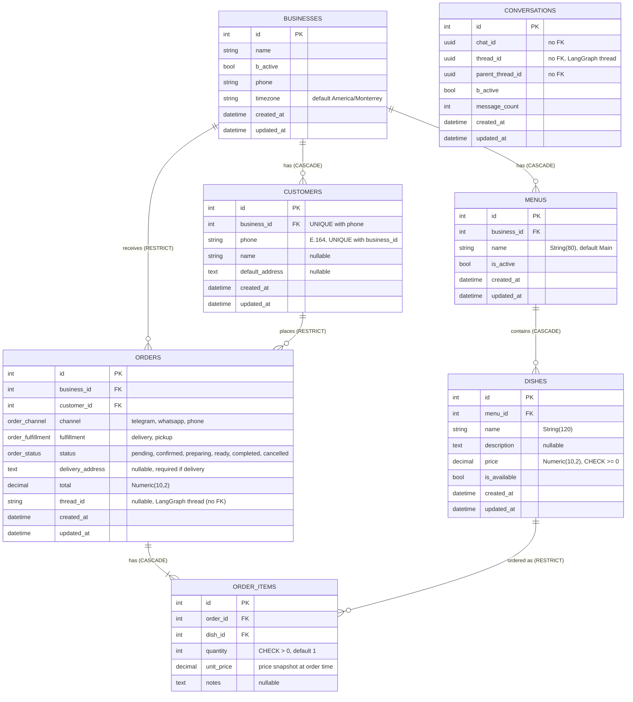

# remy_api — Database diagram

Entity-relationship diagram of the SQLAlchemy models in `remy_api/src/models/`.
Snapshot taken 2026-11-18 from `origin/main` (`src/models` identical to the `diego3008/fix-assistant-id` worktree).
Re-check the models before relying on it: schema changes ship with an Alembic migration.

## Notes

- **`conversations` is an island.** It has no foreign keys. `chat_id` is typed as a UUID, even though Telegram chat IDs
  are ints. The agent flow doesn't use this table: the thread lookup goes through LangGraph metadata.
- **`orders.thread_id` is a soft link.** It is a plain string pointing at a LangGraph thread, not a foreign key.
- **Delete behaviour:** deleting a business, menu or order cascades down the tree. Deleting a customer or dish that
  orders still reference is blocked (RESTRICT, which the API returns as 409).
- **Constraints:** `ck_order_delivery_needs_address` (delivery orders need an address), `uq_customer_business_phone`,
  `ck_dish_price_nonnegative`, `ck_order_item_quantity_positive`, and the index `ix_orders_business_status`.
- **Timestamps:** `order_items` has none (no `TimestampMixin`). `businesses` and `conversations` have no server-side
  defaults, so the route sets them.
- **Not shown:** `incoming_message.py` holds Pydantic classes (`IncomingMessage`, `AgentResponse`), not tables.
